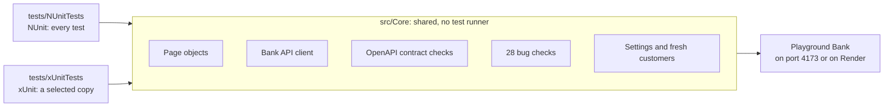

# Playwright-CSharp

[](https://github.com/asaf-1/Playwright-CSharp/actions/workflows/pr-tests.yml)
[](https://github.com/asaf-1/Playwright-CSharp/actions/workflows/pr-tests.yml)
[](https://github.com/asaf-1/Playwright-CSharp/actions/workflows/pr-tests.yml)
[](https://github.com/asaf-1/Playwright-CSharp/actions/workflows/daily-smoke.yml)

A test automation framework in **C# with Playwright for .NET**. It tests
[Playground Bank](https://agents-playground-app.onrender.com/app), the demo bank in
[Agents-Playground](https://github.com/asaf-1/Agents-Playground), through the
browser and through its API.

The same framework runs on **two test runners, NUnit and xUnit v3**, on top of
one shared core library. NUnit runs every test, and xUnit runs a selected copy.
That shows the framework doesn't depend on the runner: QA teams mostly use
NUnit, and developer teams mostly use xUnit.

## What it tests

- **UI:** sign up, log in, accounts, transfers between your own accounts, bill
  pay, CSV statements, money requests between two customers, and buying crypto.
- **API:** REST endpoints, error answers, who may see and change what
  (signed out, customer, staff, locked and read-only demo accounts), and GraphQL.
- **Contract:** 30 answers checked against the bank's own OpenAPI 3.1 spec
  (`/api/openapi.json`), status code and body schema.
- **Bug checks:** Playground Bank has 28 bugs planted on purpose, switched off
  unless a visitor turns on practice mode. Each bug has a check that runs twice:
  with practice mode off the bank must behave correctly, and with it on the
  check must catch the bug. All 28 are caught.

145 tests in all: 122 on NUnit and 23 on xUnit. Every test signs up its own new
customer (emails start with `pwcs-`), so tests never share data.

## How it's built



Page objects, the API client, settings and test data live only in `src/Core`.
The two test projects hold tests and runner setup, nothing else.

```
Playwright-CSharp/
├── src/Core/
│   ├── Api/          BankApiClient and its request and response models
│   ├── BugHunt/      practice mode and the 28 bug checks
│   ├── Config/       appsettings.json, appsettings.Live.json, TestSettings
│   ├── Contract/     the OpenAPI contract checks
│   ├── Data/         fresh customers, money, CSV statements
│   ├── Pages/        page objects and their components
│   └── Reporting/    the trace and screenshot kept when a test fails
├── tests/
│   ├── NUnitTests/   Api/  Ui/  BugHunt/
│   └── xUnitTests/   Api/  Ui/  BugHunt/
├── terraform/        the repository's settings on GitHub, as code
└── .github/          the workflows, and the steps and scripts they share
```

### Telling NUnit and xUnit apart

The runner's name is in every name, so a folder, a test result or a CI job says
which runner it belongs to.

| Where              | NUnit                        | xUnit                                 |
| ------------------ | ---------------------------- | ------------------------------------- |
| Folder and project | `tests/NUnitTests/`          | `tests/xUnitTests/`                   |
| Namespace          | `NUnitTests.*`               | `xUnitTests.*`                        |
| Test attributes    | `[Test]`, `[Category("Ui")]` | `[Fact]`, `[Trait("Category", "Ui")]` |
| Report             | `nunit-results.trx`          | `xunit-results.trx`                   |
| CI job             | `NUnit tests`                | `xUnit tests`                         |

## Run it yourself

You need the .NET 10 SDK, Node.js 20 or later, and PowerShell (`pwsh`) for
Playwright's browser install.

**1. Start Playground Bank on port 4173.** Its database lives in memory, so
every start is a fresh bank.

```bash
git clone https://github.com/asaf-1/Agents-Playground
cd Agents-Playground
npm ci
npm run build
npm start
```

**2. Build the tests and install Chromium**, in this repo, in a second terminal:

```bash
dotnet build
pwsh tests/NUnitTests/bin/Debug/net10.0/playwright.ps1 install chromium
```

**3. Run the tests:**

```bash
dotnet test --project tests/NUnitTests
dotnet test --project tests/xUnitTests
```

Run one category with a filter. The categories are `Smoke`, `Ui`, `Api`,
`Contract`, `GraphQL`, `Rules` and `BugHunt`.

```bash
dotnet test --project tests/NUnitTests --filter "TestCategory=Api"
dotnet test --project tests/xUnitTests --filter-trait "Category=Api"
```

### Settings

| Setting                       | What it does                                                                                        |
| ----------------------------- | --------------------------------------------------------------------------------------------------- |
| `TEST_ENV=Live`               | Tests the bank on Render instead of port 4173 (reads `appsettings.Live.json`, with longer timeouts) |
| `BASE_URL=...`                | Tests any other address                                                                             |
| `BROWSER=firefox` or `webkit` | Another browser (install it first, like Chromium above)                                             |
| `HEADED=1`                    | Shows the browser while the tests run                                                               |
| `PRACTICE_MODE=on`            | Turns practice mode on for every test customer, to see which planted bugs the regular tests notice  |

A failed test keeps a screenshot and a Playwright trace in the test project's
`bin/Debug/net10.0/playwright-traces/` folder. Open a trace with:

```bash
pwsh tests/NUnitTests/bin/Debug/net10.0/playwright.ps1 show-trace <path to the .zip>
```

## CI

| Workflow                                                       | When                                              | What                                                                                                                                                   |
| -------------------------------------------------------------- | ------------------------------------------------- | ------------------------------------------------------------------------------------------------------------------------------------------------------ |
| [PR tests](.github/workflows/pr-tests.yml)                     | Every pull request and push to `main`             | Three jobs side by side, each against a fresh bank started on port 4173: `NUnit tests`, `xUnit tests`, and `Bug hunt` (the bug checks on both runners) |
| [Daily smoke](.github/workflows/daily-smoke.yml)               | Every day at 8PM Israel time                      | The smoke tests on both runners, against port 4173 and against Render                                                                                  |
| [Render tests](.github/workflows/render-tests.yml)             | Only when started by hand                         | Every test on both runners, against the bank on Render                                                                                                 |
| [Terraform validate](.github/workflows/terraform-validate.yml) | Pull requests and pushes that change `terraform/` | Formatting, validity, and the guard tests for the repository's settings                                                                                |

Every job writes its counts and any failed test names to the run's summary, and
uploads the TRX reports, the bank's log, and the trace and screenshot of every
failed test.

GitHub's schedule runs in UTC, and Israel moves between UTC+2 and UTC+3. So the
daily run has two schedules, 17:00 and 18:00 UTC, and its first job keeps only
the one that is 8PM in Israel that day.

## The repository's settings as code

The repository's own settings on GitHub live in [`terraform/`](terraform/),
managed with Terraform. The record of what Terraform owns is kept in HCP
Terraform, and Terraform runs by hand on the owner's machine, with a GitHub token
limited to this one repository.

- **The rule on `main` (Repo-Main):** a change reaches `main` only through a
  pull request whose `NUnit tests`, `xUnit tests` and `Bug hunt` jobs passed.
  `main` can't be deleted or force-pushed, and nobody is exempt.
- **The repository:** description, topics, merge buttons, auto-merge, and
  deleting a branch once it's merged.
- **Guard tests** in `terraform/tests/` fail any change that loosens the rule,
  for example dropping one of the three required jobs. CI runs them on every
  change to the folder, with a mocked provider, so it needs no token.

## Built with

C# and .NET 10, Playwright for .NET 1.64, NUnit 5, xUnit v3, Microsoft Testing
Platform, JsonSchema.Net for the contract checks, GitHub Actions, and Terraform
with HCP Terraform.
